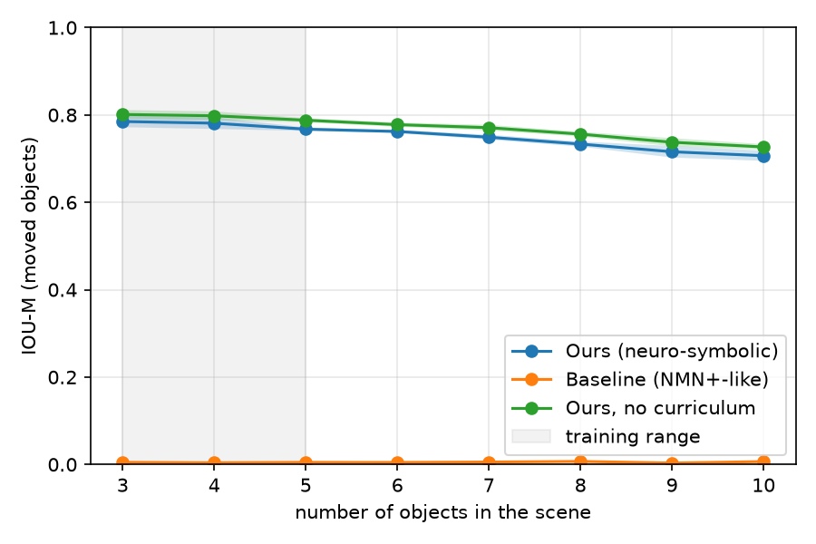
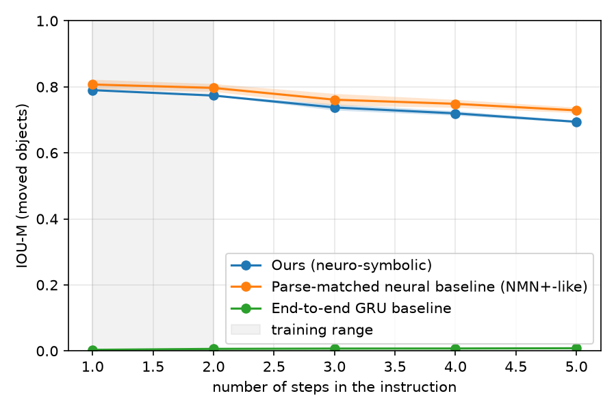

# nsrmp-mini

A small, from-scratch re-implementation of the core ideas of

> Namasivayam K., Singh H., Bindal V., Tuli A., Agrawal V., Jain R., Singla P., Paul R.
> **Learning Neuro-symbolic Programs for Language Guided Robot Manipulation.** ICRA 2023.
> [arXiv:2211.06652](https://arxiv.org/abs/2211.06652)

made for the COMP3314 bonus "reproduction" task.

## What this is, and what it is not

It **is** a simplified, runnable study of the paper's central claim: executing a *symbolic program*
over learned concepts (Filter / Relate / Unique + an Action Simulator, trained only from final
object boxes) handles relational instructions and generalises better than a purely neural
language-attention model.

It is **not** a reproduction of the paper's numbers. The world is a 2D top-down blocks world with
no images, no robot and no object detector. All code is ours; no code from the official repository was
used. The two papers' ideas (NSRMP, and NS-CL for soft concept execution) are the inspiration.
Our numbers and the paper's numbers are measured on different data and **must not be compared as
like with like**.

## Paper module -> our file

| Paper | File |
|---|---|
| Sec. IV-A dataset (here: synthetic scenes, instructions, gold programs, gold final states) | `nsrmp/data.py` |
| Sec. III-A language parser (given, as in the paper's "program supervision" ablation) | `nsrmp/parser.py` |
| Sec. III-B Visual Reasoner: Scene / Filter / Relate / Unique, NS-CL style soft execution | `nsrmp/executor.py`, `Concepts` in `nsrmp/model.py` |
| Sec. III-C Action Simulator, predicted final world | `ActionSimulator`, `apply_move`, `NSModel` in `nsrmp/model.py` |
| Sec. III-D loss and curriculum training | `nsrmp/train.py` |
| Sec. IV-B NMN+ baseline (Fig. 3) | `nsrmp/baseline.py` |
| Sec. IV-B metrics (IOU, IOU-M, subject and placement accuracy) | `nsrmp/metrics.py` |
| Table II, Fig. 4a, Fig. 4b | `run_experiments.py` |

## Simplifications and why

- **No images, no detector.** "Visual features" are `P · [onehot(colour); onehot(shape)] + N(0, 0.1²)`
  with a fixed random 32x9 matrix `P`. We have no YOLO/ResNet, so only the paper's **gold-BB** setting is
  tested; the "extracted BB" rows of Table II have no analogue here. Concepts are trivially separable
  from these features, which makes the *concept* part easy (see discussion).
- **Given parser.** A deterministic rule-based parser produces the programs (the paper trains its own
  language encoder, with a given-program ablation in its repo). This removes the language-learning part.
- **Templated language.** ~15 words, one sentence template, relations only through "which is <relation> the <simple object>".
  Every referring expression selects exactly one object (the generator checks this).
- **Four actions** (`MoveLeft/Right/Front/Behind`) with a fixed gap; the paper has a richer action set.
- **Action Simulator = residual MLP** (output is added to the subject box) and the relation MLP also
  receives the scaled difference of the two boxes. Both only make optimisation easier; neither changes the idea.
- **Cosine learning-rate decay** (both models). Without it IOU-M of our model plateaus near 0.66 because
  the Action Simulator never gets precise.
- **Filter threshold/temperature** fixed at `gamma=0.2`, `tau=0.1` (NS-CL style).
- **Multi-step**: the splitter on "then" is given and shared by both models (the paper's LSTM splitter is learned).
- **Metrics**: IOU averages over all objects, IOU-M pools all moved objects. Subject accuracy is averaged over steps.
  Placement accuracy: the predicted box centre of a moved object lies inside its gold final box.
  The paper's exact aggregation may differ.

## Setup and run

```bash
uv venv --python 3.12 .venv
uv pip install --python .venv/bin/python -r requirements.txt
.venv/bin/pytest -q                              # 47 tests
.venv/bin/python run_experiments.py --phase all  # ~7 min on an M2 Pro CPU
.venv/bin/python diagnose_baseline.py            # ~2 min, explains the baseline result
```

Settings used for the results below: 4000 train / 1000 test examples (50/50 simple/complex, 3-5 objects),
**60 epochs**, Adam lr 3e-3 with cosine decay, batch 64, curriculum = first 20 epochs simple-only, 3 seeds (0, 1, 2),
500 test examples per object count (3..10) or step count (1..5). Both models get identical data, epochs,
Action Simulator architecture and loss (`sum_i |box_hat_i - box_i|_1 + 1 * (1 - IoU)`). The full run took
**7 min 7 s** (phase 1: 217 s, phase 2: 206 s, plus data generation). Mean ± std is over the 3 seeds
(population std, `np.std`); each seed changes the data, initialisation and shuffling.

## Our results (synthetic 2D world, gold boxes)

### Table II analogue, test set with 3-5 objects, single step

| Model | IOU | IOU-M | IOU-M simple | IOU-M complex | Subject acc. simple | Subject acc. complex | Placement acc. |
|---|---|---|---|---|---|---|---|
| Ours (neuro-symbolic) | 0.929 ± 0.001 | 0.776 ± 0.004 | 0.779 ± 0.005 | 0.774 ± 0.003 | 1.000 ± 0.000 | 0.999 ± 0.001 | 0.955 ± 0.004 |
| Baseline (NMN+-like) | 0.744 ± 0.002 | 0.005 ± 0.001 | 0.005 ± 0.001 | 0.004 ± 0.001 | 0.281 ± 0.015 | 0.249 ± 0.008 | 0.007 ± 0.001 |
| Ours, no curriculum (ablation) | 0.935 ± 0.001 | 0.796 ± 0.004 | 0.797 ± 0.006 | 0.795 ± 0.006 | 1.000 ± 0.000 | 1.000 ± 0.000 | 0.969 ± 0.003 |

### Fig. 4a analogue: IOU-M vs number of objects (trained on 3-5)



| Model | 3 | 4 | 5 | 6 | 7 | 8 | 9 | 10 |
|---|---|---|---|---|---|---|---|---|
| Ours | 0.785 ± 0.013 | 0.781 ± 0.013 | 0.767 ± 0.004 | 0.762 ± 0.003 | 0.749 ± 0.006 | 0.733 ± 0.006 | 0.716 ± 0.013 | 0.707 ± 0.012 |
| Baseline | 0.005 ± 0.003 | 0.004 ± 0.002 | 0.005 ± 0.000 | 0.005 ± 0.003 | 0.006 ± 0.002 | 0.007 ± 0.001 | 0.003 ± 0.002 | 0.007 ± 0.001 |
| Ours, no curriculum | 0.801 ± 0.010 | 0.798 ± 0.010 | 0.788 ± 0.005 | 0.778 ± 0.005 | 0.771 ± 0.006 | 0.756 ± 0.005 | 0.738 ± 0.009 | 0.727 ± 0.006 |

### Fig. 4b analogue (phase 2): trained on 1-2 steps, tested on 1-5 steps (3-5 objects)

On the 1-2 step test set: ours IOU 0.905 ± 0.001, IOU-M 0.776 ± 0.002, subject acc. 0.999 ± 0.000;
baseline IOU 0.657 ± 0.001, IOU-M 0.007 ± 0.001, subject acc. 0.272 ± 0.002.



| Model | 1 | 2 | 3 | 4 | 5 |
|---|---|---|---|---|---|
| Ours | 0.790 ± 0.001 | 0.774 ± 0.001 | 0.738 ± 0.008 | 0.720 ± 0.006 | 0.694 ± 0.003 |
| Baseline | 0.003 ± 0.001 | 0.006 ± 0.001 | 0.007 ± 0.001 | 0.007 ± 0.001 | 0.008 ± 0.001 |

Raw per-seed numbers: `results/phase1.json`, `results/phase2.json`; tables: `results/results_phase{1,2}.md`.

## From the paper (Table II / Fig. 4), gold bounding boxes

| Model | IOU | IOU-M overall | IOU-M simple | IOU-M complex |
|---|---|---|---|---|
| Ours (gold BB) | 0.87 | 0.72 | 0.73 | 0.64 |
| NMN+ (gold BB) | 0.77 | 0.55 | 0.71 | 0.31 |

Fig. 4 gives no numbers, only the trend: the paper's model degrades more gracefully than the baseline
as the number of objects (4a) and steps (4b) grows. The paper reports no standard deviations.

## Discussion

**Where we agree with the paper.** Our neuro-symbolic model beats the neural baseline on every metric, it is equally good on
simple and complex instructions (IOU-M 0.779 vs 0.774; the paper: 0.73 vs 0.64), and its IOU-M degrades gently
when scenes have up to 2x more objects than in training (0.77 -> 0.71) or instructions have up to 2.5x more steps
(0.79 -> 0.69). The relation classifier was learned *without any relation labels*, only from final boxes,
and grounds complex subjects correctly (subject accuracy 0.999).

**Where we do not reproduce the paper, and why.**
1. **The baseline completely fails (IOU-M ~ 0.005), unlike the paper's NMN+ (0.71 simple / 0.31 complex).**
   So our experiment cannot show the paper's simple-vs-complex gap for the baseline, and the Fig. 4 comparison is
   "ours vs a baseline that does not work", not a trend comparison. This is a **real, reproducible
   optimisation failure**, not a measurement bug (`diagnose_baseline.py`): its final training loss (2.29) equals the loss of
   simply moving nothing (2.22 on the test set), so IOU stays high (0.74, most objects do not move)
   while IOU-M is ~0. With the *gold subject given* the same network learns to move boxes (IOU-M 0.52), and with an
   *extra subject-supervision loss* (not used in the results) it grounds subjects with 0.86 accuracy. So the
   architecture can represent the task; what fails is discovering subject grounding from the final-box loss alone,
   because subject, reference and Action Simulator all have to be right at the same time to reduce the loss.
   The NS model escapes this because its structure (shared concept embeddings, given program) supplies the
   inductive bias. We tried wider heads, product / dot-product attention, learning rates 5e-4 to 1e-2, batch sizes 16-256,
   4x more data, 100 epochs, sharper attention, and removing the box input from the attention heads; none helped, so we kept
   the baseline exactly as the spec describes. The paper's NMN+ was presumably better engineered or has other inputs;
   our baseline is likely weaker than a well-tuned one, and the size of our gap should not be read as evidence for the paper.
2. **Absolute numbers differ and are not comparable** (synthetic data, templated language, different metric aggregation).
   Our IOU-M ceiling (~0.78-0.80) comes from Action Simulator precision, not grounding: subject accuracy is ~1.0 and
   placement accuracy 0.96, but boxes are only ~0.1 wide, so a 0.02 placement error already costs a lot of IoU.
3. **Subject accuracy ~1.0 is genuine but easy.** An untrained model scores ~0.28 (chance); the high score arises
   because noisy one-hot features are almost perfectly separable and every referent is unique by construction.
   The paper's real images are much harder.
4. **Curriculum did not help here.** Training on all instructions from the start was slightly *better* (IOU-M 0.796 vs 0.776). The
   paper uses a curriculum; in our easy world it is unnecessary (this is one ablation, 3 seeds).
5. **Standard deviations are small** (mostly <= 0.01) because data and features are synthetic and the model is small;
   they reflect seed variance only, not variance from a different world or a different generator.
6. Generalisation in our setting degrades partly because softer `Unique` weights and relation errors accumulate with
   more objects / steps (predicted boxes of earlier steps feed later ones); we did not isolate which factor dominates.

## Our contributions vs reused

Everything in this repository was written by us from the paper text: the world and generator, parser, soft executor,
concept/relation/Action-Simulator networks, baseline, metrics, training and experiment scripts, and tests (written test-first).
The *ideas* come from NSRMP (program-based visual reasoning + Action Simulator trained from final states, curriculum, NMN+
comparison) and from NS-CL (soft Filter/Relate/Unique execution with concept embeddings). We reused no code from either project;
the only third-party libraries are PyTorch, NumPy, Matplotlib and pytest.

## Honest limitations

Gold boxes only; given parser and splitter; synthetic templated language; 3 seeds; one fixed hyper-parameter setting shared by both
models (chosen on seed-0 data of our own model, not tuned per model); the baseline failure above.
